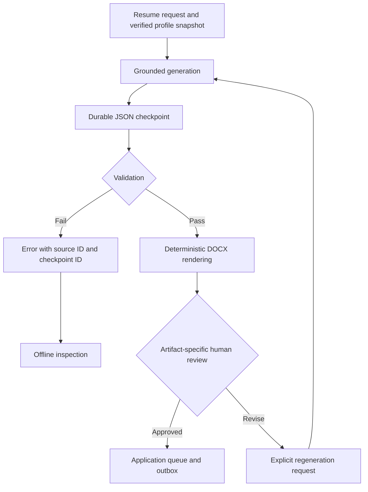

# Architecture decision: modular application with durable stages

Status: initial engineering baseline; business fallback boundaries and additional profile facts remain unconfigured.

## Four modules

| Module | Input | Output |
| --- | --- | --- |
| Discovery/intake | Requirements, source or URL | Normalized job, captured JD, provenance, qualification |
| Resume preparation | Job + immutable verified profile version | Validated content + fixed-template artifact |
| Account access | Employer tenant + account reference | Session or blocker |
| Application | Job + artifact + session + approved answers | Confirmation, blocker, or submission uncertainty |

A coordinator will persist transitions and claim bounded work. Modules depend on domain contracts; browser, model API, mailbox, and storage are adapters. Start with SQLite for local use. Multiple hosts will require a database with suitable job-claim concurrency and migrations; do not treat SQLite as a distributed queue.

## Implemented boundary

The first increment covers captured JSON -> validation -> normalization -> title/location qualification -> transactional upsert + attempt history. It establishes durable intake only. No browser or worker coordinator exists yet. SQLite schema version is 1; introduce explicit migrations before changing deployed schemas.

## Planned workflow

Discovered -> qualified/excluded -> resume_ready -> account_ready -> applying -> submission_pending -> submitted.

Any stage can record a blocker. Account access may be requested midway through application navigation. Retry counts and timeouts must be bounded. Persist submission_pending before attempting Submit; an interrupted attempt becomes submission_unknown and must reconcile with employer confirmation before any retry.

## Identity and facts

Job identity is shared across email accounts. Explicit employer keys and requisition IDs are preferable to URLs. Resume/profile versions are immutable inputs to later stages. Two email accounts never justify different invented employment histories. Sensitive factual answers come from explicitly verified values. Secrets, mailbox tokens, sessions, and generated candidate documents must stay outside Git and model prompts unless specifically required and appropriately scoped.

## Acceptance and testing

Current: importing the same job twice, including a requisition URL alias, retains one job and two attempt records across database reopening. Invalid data is not imported. URL tracking cleanup preserves meaningful requisition parameters. ATS detection checks host boundaries.

Next: fixture-based fetch tests, extraction completeness, explicit failure persistence, transition/lease recovery, account isolation, and post-submit timeout reconciliation. Live applications are not the regression suite.

## Discovery dashboard and resume handoff (increment 2)

The local HTTP server serves an interactive HTML client. `POST /api/runs` creates an asynchronous discovery run; `GET /api/state` reads persisted runs, jobs, activities, and queue entries. The browser polls every two seconds. No model is called: a documented title-prompt grammar plus explicit location, exclusion, and JD-phrase fields produces deterministic rules. A board fetch or individual posting failure is recorded while other sources continue.

Public read adapters: Greenhouse Job Board API (`content=true`) and Lever Postings API (bounded pagination). Network calls have a 20-second timeout and an 8 MB response cap. Board identifiers are validated; arbitrary hosts and redirects are not accepted. Company labels currently use board tokens. References: https://docs.greenhouse.io/job-board.html and https://github.com/lever/postings-api .

Matches produce an immutable `resume_queue` snapshot. Queue insertion and the corresponding `outbox` insert share one transaction. A unique job ID prevents duplicate enqueues across searches. Intake records and activity are separate from this transaction; a crash before enqueue is recoverable by rerunning discovery. An existing queued snapshot is not replaced when the job is fetched again with different criteria. Stage 2 must revalidate job availability and the current candidate profile before generation/application.

Event topic: `resume.requested.v1`. Payload: schema_version, queue_order, job_id, job snapshot (including URL, full JD, source, and qualification), and status. Event key: `resume.requested:<job_id>`.

This is a SQLite transactional outbox, not an installed Kafka broker. A future relay can publish outbox rows and mark published_at after broker acknowledgement; consumers must deduplicate by event_key because relay retries can redeliver. Consumer leases, acknowledgements, retries, dead-letter handling, and resume generation are deferred to stage 2. There is no consumer in this increment.

The default server listens on loopback only and rejects cross-origin POST requests. It is a local development server, not an internet-facing deployment. Each discovery run has persisted config and activity; restarts mark old running records interrupted. One run per process prevents overlapping producers; multi-process ownership/leases are future work.

## Expanded discovery and first GPT consumer (increment 3)

Ashby is now a public direct-board connector; unlisted jobs are omitted. Adzuna is an optional cross-employer search adapter configured with server-only credentials. It cannot guarantee all-market coverage and its excerpts are not treated as complete JDs: those leads are persisted as needs_full_jd and never generate resume requests. Full-JD enrichment and dedicated LinkedIn/Indeed/Workday search connectors remain unimplemented. Source capability and configuration state are exposed without secrets. Defaults can be loaded from a local sources-file; explicit run sources override them.

`agent.resume_worker` is a separate process consuming the versioned request contract from the local outbox. It joins the durable queue, claims under BEGIN IMMEDIATE, and uses token-checked 300-second leases. A stale worker cannot overwrite a newer worker's result. Queue status moves resume_waiting -> resume_processing -> resume_draft_ready, or resume_error. Errors back off by 30 seconds per attempt, with three attempts maximum. An exhausted expired lease is marked as an error rather than staying processing forever.

Success commits the fact-selection draft, consumer receipt, queue state, activity, and resume.drafted.v1 event together. A unique (consumer,event_key) receipt prevents repeat local processing after success. Delivery is at least once at the external API boundary: an API response lost before local commit may be regenerated and incur another charge. The existing outbox published_at field is reserved for a future broker relay; local consumer acknowledgements live in consumer_receipts and do not claim broker publication.

Profile facts are loaded from a local verified catalog and hashed. The API receives only title/company/JD/link and verified professional facts, with store=false and strict JSON Schema output. GPT returns only ordered fact IDs and unsupported requirements. Unknown/duplicate IDs, refusals, incomplete responses, or oversized input fail the task. Final fact text and section membership come from the local catalog. Current output is a draft selection, not a finished resume artifact or a proof of job eligibility. Approved formatting, immutable candidate-version selection for multiple profiles, DOCX/PDF rendering, and later-stage revalidation remain separate work.

Schema additions are backwards-compatible tables and transactional column checks. Queue and intake identity are unchanged, preserving existing local waiting entries. Run only one discovery server per database; independent resume workers coordinate task claims through SQLite.

## Agent 2 DOCX packaging and Agent 3 queue (increment 4)

The Agent 2 process now orchestrates two durable substeps. The GPT consumer checkpoints selected facts and acknowledges its request through resume-gpt-v1. A packager consumes the resulting resume.drafted.v1 event through resume-packager-v1. This intermediate durable event allows crash recovery without regenerating GPT content. Final acknowledgement, artifact metadata, application queue entry, activity, and applications.ready.v1 event commit atomically after file creation and validation.

Packager claims use their own BEGIN IMMEDIATE transaction, random token, 300-second lease, bounded three-attempt retries, and backoff. A stale token cannot publish. DOCX files are stored first under SHA-256 names using temp-file/replace publication. The DB transaction then exposes the artifact. If that transaction fails, an orphan file may remain, but the task remains unacknowledged and no application-ready event is visible. This is durable at the local process/database boundary; external shared/object storage is a future adapter.

The renderer uses exact local verified header and fact text, stable ZIP metadata, explicit Calibri fonts, bold headings, and preserved hyperlinks. It validates archive integrity, exact text, hyperlink targets, typography, and absence of inherited title borders. It has a bounded word budget but does not assert runtime page count or visual correctness. The validation scope and page_count_verified=false travel in the event. Representative layout QA was performed in development. Eligibility remains not_assessed, and unsupported job requirements remain visible in the outgoing JSON.

The message includes schema_version, event_id, correlation_id, job_id, profile_version, job snapshot with full JD, resume artifact locator/hash/validation, and application_queue_order. The local artifact URI is logical; Agent 3 on the same host uses the database/storage adapter. Multi-host deployment requires a shared storage adapter and broker relay rather than assuming local paths are globally readable.

The dashboard exposes a separate Agent 3 queue and checksum-checked DOCX downloads. There is no Agent 3 consumer, account creation, or browser submission in this increment. Historical draft-only records require their original profile version; header changes must not silently alter candidate identity.

## Grounded writer and review gate (current Agent 2)

New API calls use grounded-writer-v1: a generated summary with source IDs,
verbatim source-backed skill names, and 2–5 rewritten bullets per selected
experience/project entry. Source IDs are constrained by the request schema.
Validation requires every supplied employment entry, at least one project when
projects exist, and copies education unchanged. Structured role headings, dates
and original link targets remain local. Numeric checks and evidence references
are partial checks, not a semantic correctness guarantee.

The renderer checks exact equality against the validated written draft, not
against the old source prose. It recomputes draft validation against the original
profile before packaging. A new artifact enters application_queue with
status=review_required, and does not produce applications.ready.v1 until an
explicit approval for its exact artifact ID. The Agent 3 view excludes
unapproved and regenerating entries. This is a local review gate; future
consumers must enforce status and revision too.

Legacy fact-selection drafts remain supported. Approval is performed through
the local same-origin API with artifact checksum verification. Regeneration
revokes the unpublished old ready event after a successful replacement and
requires a fresh review. Previous artifacts and payloads remain in revision
history. Already-published handoffs cannot be replaced by this local workflow.

Offline tests exercise structured response validation and the complete local
pipeline with fixed responses. They do not establish live model quality,
candidate eligibility, or exact Word pagination.

## Agent 2 reliability boundary (grounded-writer-v2)

The acceptance target is evidence traceability and an explicitly reviewed artifact,
not a percentage claim of AI accuracy. Structural conformance, factual meaning,
job relevance and document layout are different checks.

Implemented flow:

Responsibilities:

- Profile: user verifies source evidence; employer/title/date anchors and education
  remain local. The model receives professional facts, not the local contact header.
- Writer: selects relevant content and rewrites only within the cited entry's scope.
  One to five bullets are permitted. A sparse fact must not be padded to meet a
  two-bullet quota. Entry IDs in the schema only include Experience and Projects.
- Contract: schema and validator share array limits. Shape validation is combined
  with existing reference, exact-skill, numeric, employment coverage and project
  coverage checks. Length and semantic rules still require local checks/review.
- Checkpoint: parsed JSON output and its source snapshot are committed before
  validation. Initial generation and regeneration share this boundary. A request key
  includes logical task, job, professional profile, model and writer version.
  Reprocessing the same request revalidates the saved response without another
  model call. A new explicit regeneration request is a separate paid operation.
- Inspection: `python -m agent.resume_checkpoint --database data/agent.db` lists
  checkpoint metadata. Add `--id UUID` to inspect entry counts and revalidate using
  current code. This is read-only: it never publishes, approves or regenerates.
- Rendering/review: existing deterministic renderer, checksum validation and
  artifact-specific approval remain. Failed replacements retain the old artifact.
  Only approved new writer artifacts publish `applications.ready.v1`.

Migration is additive: the checkpoint table is created on first generation; no
existing profile, queue or artifact is deleted. Old v1 written drafts retain their
original validation version. Old failures have no checkpoint and cannot be recovered.
Checkpoints live in the private local database; do not commit or share that database.

Limitations: citations and numeric checks cannot prove semantic truth. Human review
remains required. This increment does not implement an independent semantic critic,
a fact-level claim editor, PDF pagination verification or a multi-host Kafka broker.
Parsed completed JSON is checkpointed; network errors, incomplete/refused responses
and malformed JSON are not recoverable checkpoints. A crash after the provider has
responded but before the SQLite commit may require another call. Existing leases
protect task ownership; this is not exactly-once provider billing.

Next architecture increment, after this foundation is evaluated: normalized claim
records (employer/project scope, exact evidence, dates, skills and metrics), a
requirement-to-claim map, bullet-level evidence and a side-by-side correction UI.
An optional semantic verifier may flag unsupported paraphrases but cannot replace
source verification or artifact approval. Evaluate on redacted representative
profiles/JDs with a human-scored claim checklist before enabling it by default.

Release criteria for this increment: array boundary tests, failed-response replay
without a generator call, snapshot isolation, read-only offline inspection, old
writer-version compatibility, failed replacement retention, review-gated outbox,
and the existing end-to-end tests. Synthetic tests validate mechanics, not live
model quality. Publish all changes together after these checks pass.

## Manual full-JD rescue for market leads

A search excerpt cannot enter Agent 2. To unblock selected leads without relying
on untrusted automated web extraction, the loopback-only dashboard accepts a
user-confirmed complete JD through `POST /api/jobs/enrich`. Input includes the
existing 24-character job ID, 300–80,000 characters of pasted description,
an explicit `confirmed_complete` true flag, and an optional canonicalizable
employer URL. No arbitrary network retrieval occurs.

Each newly discovered job now persists the original rules and run ID. Enrichment
requalifies against those recorded rules under a SQLite `BEGIN IMMEDIATE`
transaction and updates the job, intake attempt, queue, activity and outbox
atomically. A failed event insert rolls back the qualification update as well.
The job ID is stable: the original search identity is not rebound to the optional
employer URL. Later excerpt-only refreshes preserve the manually supplied JD,
while re-running qualification against the new search rules. Previously saved
leads lacking stored rules must be rediscovered before enrichment.

Provenance is `user_pasted_unverified`: a checkbox confirms user intent, **not**
external truth or a legal eligibility decision. Resumes remain subject to existing
evidence validation and artifact-specific human approval. Re-enrichment is not
a way to mutate an already queued immutable resume snapshot; the endpoint only
accepts `needs_full_jd` excerpts.

## Agent 3 preflight consumer and OTP mailbox boundary

Agent 3 consumes only `application_queue.status=ready_for_application`
records with an existing `applications.ready.v1` event. Its private
`agent3_tasks` table is populated idempotently; BEGIN IMMEDIATE claims have
tokens, leases and bounded retries. A task is not processed if its resume is
still `review_required`, being regenerated, or revoked. Preflight verifies
payload vs event, exact artifact-specific approval, profile version, saved
bytes/SHA-256 and HTTPS qualified job URL. A successful task is
`awaiting_browser_adapter`, with a plan explicitly marked
`submission_performed=false`. No employer API/HTML POST occurs.

The dashboard now displays every packaged application row, not only
ready rows; the Agent 3 task stage is shown alongside any review blocker.
The dashboard POST `/api/agent3/preflight` is a same-origin local action
that executes up to 10 preflights, with no external network access.

Gmail OTP retrieval is isolated behind `agent.gmail_otp`. A separate local
OAuth Desktop consent uses only the `gmail.readonly` scope, and only the
`messages.list` and `messages.get` read endpoints. The adapter requires one
literal sender address, a dedicated label and a timestamp younger than 15
minutes, checks sender headers and internal message date again, and extracts
one unambiguous six-digit code from text/plain content. Codes and message
bodies are never written to SQLite or logs. The Gmail API scope itself can
read the whole mailbox: sender/label/time are restrictions enforced in our
code, not by Google's OAuth permissions. An independent mailbox provides
stronger isolation. Actual ATS OTP consumption is not yet implemented.

Next increment: explicit candidate application-answer schema, browser session
adapter per ATS (do not assume universal form layout), access-blocker/OTP
handoff, final user review, durable `submission_pending` before external
Submit, and reconciliation to `submitted` only after employer confirmation.
Never retry a timed-out Submit just because a response was lost.
